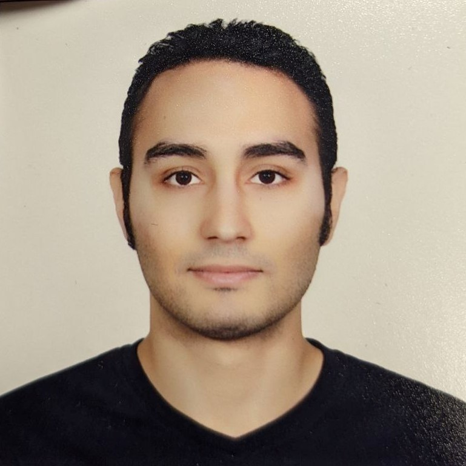
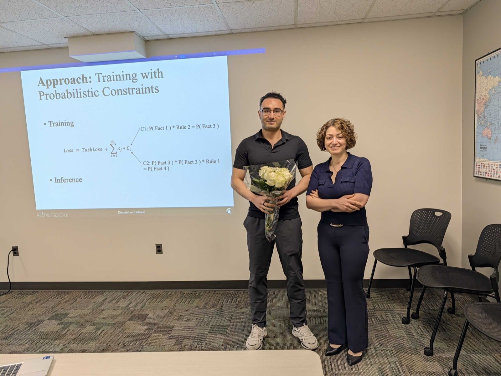

---
hide:
  - navigation
  - toc
---

# Aliakbar Nafar

Machine Learning Engineer II at BetterHelp &middot; Philadelphia, PA PhD in Computer Science, Michigan State University (defended October 2026)

I build LLM agents and evaluation systems at BetterHelp (Teladoc Health). I defended my PhD at Michigan State University in October 2026, on modeling uncertainty with large language models, as a member of the [HLR Lab](https://hlr.github.io/). NAACL 2025 Outstanding Paper Award.

[:material-email: Email](mailto:&#110;&#97;&#102;&#97;&#114;&#97;&#108;&#105;&#64;&#109;&#115;&#117;&#46;&#101;&#100;&#117;){ .md-button .md-button--primary }
[:fontawesome-brands-github: GitHub](https://github.com/DariusNafar){ .md-button }
[:fontawesome-brands-linkedin: LinkedIn](https://www.linkedin.com/in/anafar/){ .md-button }
[:simple-googlescholar: Google Scholar](https://scholar.google.com/citations?user=RnsQD44AAAAJ&hl=en){ .md-button }
{ .profile-links }

## Highlights

-   :material-trophy-outline:{ .lg .middle } **NAACL 2025 Outstanding Paper Award**

    ---

    First author of "Learning vs Retrieval: The Role of In-Context Examples in Regression with LLMs".

    [:octicons-arrow-right-24: Paper](https://aclanthology.org/2025.naacl-long.417/) &nbsp; [:octicons-arrow-right-24: Award](https://2025.naacl.org/blog/best-papers/)

-   :material-file-document-outline:{ .lg .middle } **EMNLP 2026, Main Conference**

    ---

    "Analyzing LLM Reasoning to Uncover Mental Health Stigma", from my work at BetterHelp. Code and data are open source.

    [:octicons-arrow-right-24: Paper](https://aclanthology.org/2026.emnlp-main.1835/) &nbsp; [:octicons-arrow-right-24: Code](https://github.com/BetterHelp/llm-stigma-reasoning)

-   :material-school-outline:{ .lg .middle } **PhD defended, October 2026**

    ---

    Dissertation: "Modeling Uncertainty with Large Language Models". Michigan State University, advised by Parisa Kordjamshidi.

    [:octicons-arrow-right-24: HLR Lab](https://hlr.github.io/)

-   :material-source-branch:{ .lg .middle } **DomiKnowS**

    ---

    Open-source declarative neuro-symbolic framework in Python and PyTorch, built with 12+ researchers and developers.

    [:octicons-arrow-right-24: GitHub](https://github.com/HLR/DomiKnowS)

## Selected publications

- **Learning vs Retrieval: The Role of In-Context Examples in Regression with LLMs**{ .pub-title } 
  **Aliakbar Nafar**, Kristen Brent Venable, Parisa Kordjamshidi 
  *NAACL 2025*{ .venue } *Outstanding Paper Award*{ .venue .award } 
  [ACL Anthology](https://aclanthology.org/2025.naacl-long.417/){ .pub-link } [Code](https://github.com/HLR/LvsR-LLM){ .pub-link }

- **Reasoning over Uncertain Text by Generative Large Language Models**{ .pub-title } 
  **Aliakbar Nafar**, Kristen Brent Venable, Parisa Kordjamshidi 
  *AAAI 2025*{ .venue } 
  [AAAI Paper](https://ojs.aaai.org/index.php/AAAI/article/view/34674){ .pub-link } [Code](https://github.com/HLR/BLInD/){ .pub-link }

- **Extracting Probabilistic Knowledge from Large Language Models for Bayesian Network Parameterization**{ .pub-title } 
  **Aliakbar Nafar**, Kristen Brent Venable, Zijun Cui, Parisa Kordjamshidi 
  *TMLR, May 2026*{ .venue } 
  [OpenReview](https://openreview.net/forum?id=Fy3Byg3CVo){ .pub-link } [arXiv](https://arxiv.org/abs/2505.15918){ .pub-link } [Code](https://github.com/HLR/llm-bn-parameterization){ .pub-link }

[All publications :octicons-arrow-right-24:](publications.md)

## News

- **Oct 2026** Presented "[Analyzing LLM Reasoning to Uncover Mental Health Stigma](https://aclanthology.org/2026.emnlp-main.1835/)" at [EMNLP 2026](https://2026.emnlp.org/), Main Conference.
- **Oct 2026** Defended my PhD dissertation, "Modeling Uncertainty with Large Language Models", at Michigan State University with the [HLR Lab](https://hlr.github.io/). 
- **Sep 2026** "[An Agentic Framework for Neuro-Symbolic Programming](https://openreview.net/forum?id=Ci0649msfg)" published at [NeSy 2026](https://2026.nesyconf.org/).
- **May 2026** "[Extracting Probabilistic Knowledge from Large Language Models for Bayesian Network Parameterization](https://openreview.net/forum?id=Fy3Byg3CVo)" published in [TMLR](https://jmlr.org/tmlr/).
- **Jan 2026** "[An Agentic Framework for Neuro-Symbolic Programming](https://arxiv.org/abs/2601.00743)" posted to arXiv.

??? news-older "Older news"

    - **Jan 2026** Submitted "[Extracting Probabilistic Knowledge from Large Language Models for Bayesian Network Parameterization](https://arxiv.org/abs/2505.15918)" to [TMLR](https://jmlr.org/tmlr/).
    - **Aug 2025** Bayesian-network parameterization preprint [arXiv](https://arxiv.org/abs/2505.15918) and [GitHub](https://github.com/HLR/llm-bn-parameterization) updated.
    - **Apr 2025** Awarded the [Carl V. Page Memorial Graduate Fellowship](https://engineering.msu.edu/about/departments/cse/outreach-and-services).
    - **Apr 2025** Our paper received the [NAACL 2025 Outstanding Paper Award](https://2025.naacl.org/blog/best-papers/).
    - **Apr 2025** Selected as a [NAACL 2025 volunteer](https://2025.naacl.org/calls/volunteers/).
    - **Jan 2025** "[Learning vs Retrieval: The Role of In-Context Examples in Regression with LLMs](https://aclanthology.org/2025.naacl-long.417/)" accepted to NAACL 2025.
    - **Dec 2024** "[Reasoning over Uncertain Text by Generative Large Language Models](https://ojs.aaai.org/index.php/AAAI/article/view/34674)" accepted to AAAI 2025.

## Service

Reviewer and program committee member for [ACL Rolling Review](https://aclrollingreview.org/), [AAAI](https://aaai.org/), [COLM](https://colmweb.org/), [NeSy](https://2026.nesyconf.org/) and [TMLR](https://jmlr.org/tmlr/).

[All service :octicons-arrow-right-24:](service.md)
