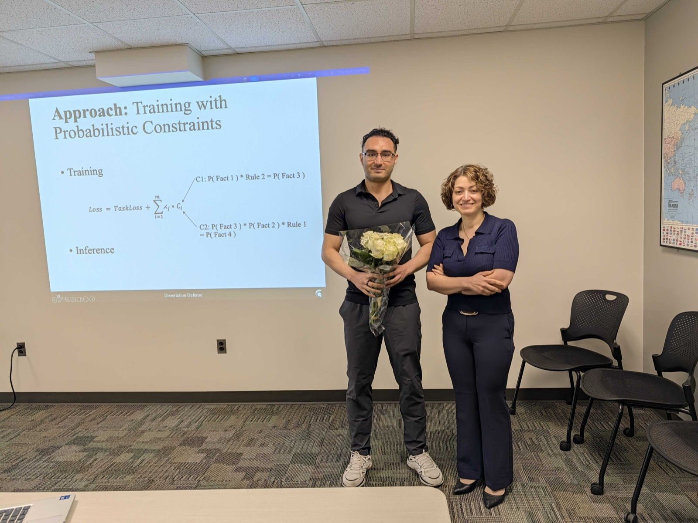
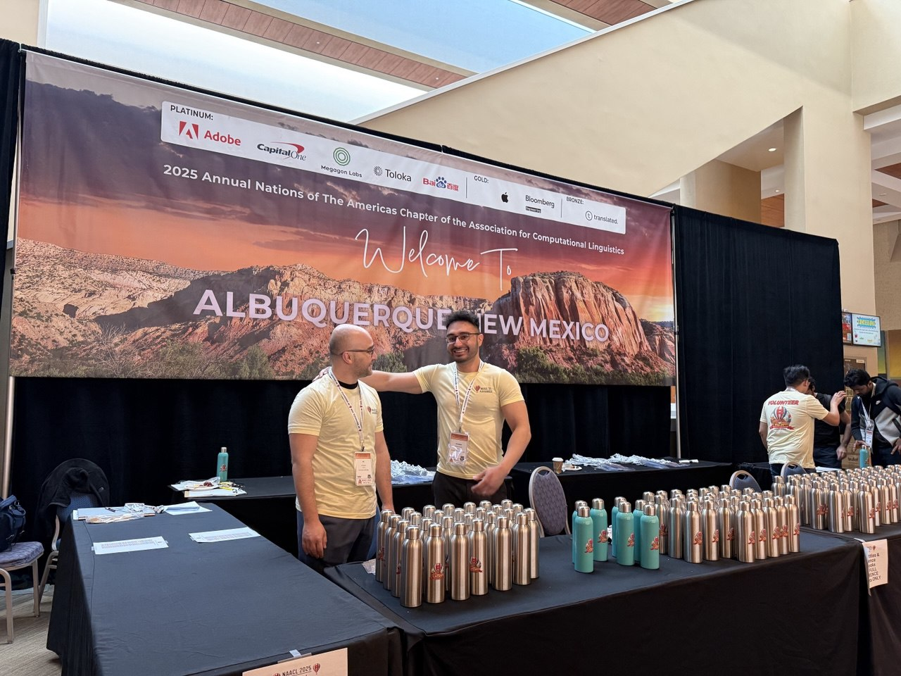
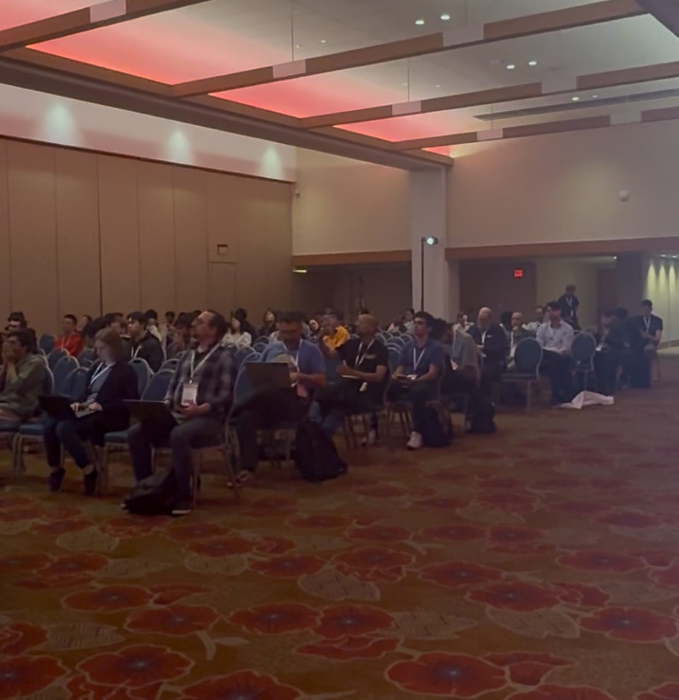
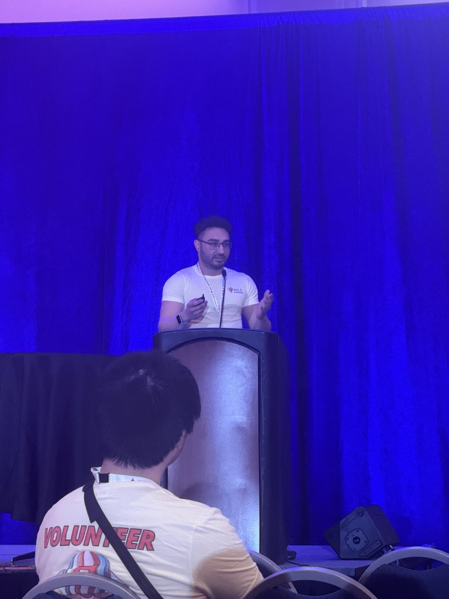
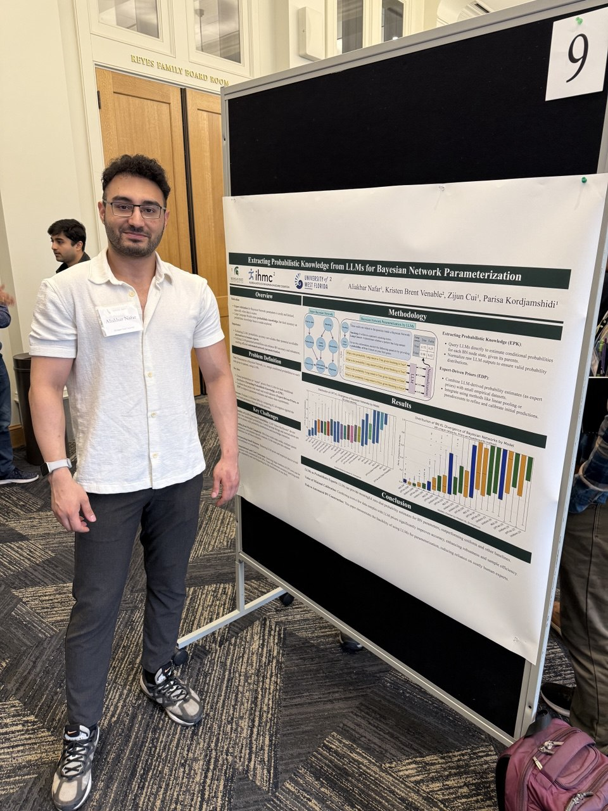
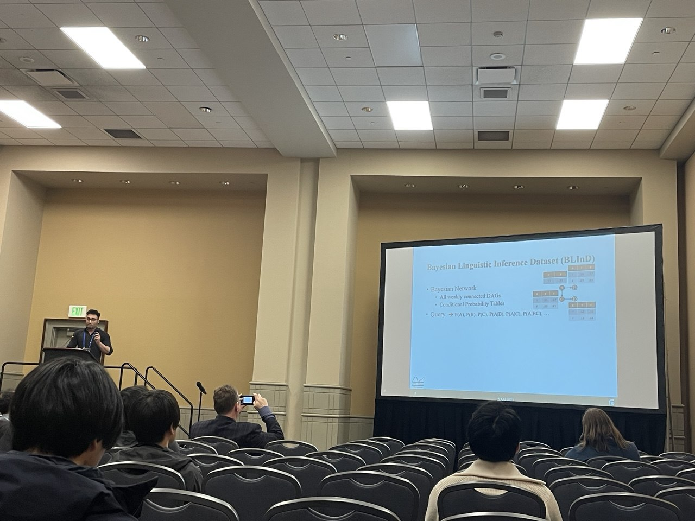

---
hide:
  - navigation
---

# Talks & Presentations

Conference presentations and my dissertation defense, newest first.

### EMNLP 2026 · Virtual talk
- **Title:** Analyzing LLM Reasoning to Uncover Mental Health Stigma
- **Event:** [2026 Conference on Empirical Methods in Natural Language Processing](https://2026.emnlp.org/)
- **Type:** Virtual presentation, Main Conference
- **Date & Place:** October 25, 2026 | Virtual session (conference in Budapest, Hungary)
- **Materials:** [Paper](https://aclanthology.org/2026.emnlp-main.1835/) · [Code](https://github.com/BetterHelp/llm-stigma-reasoning)

---

### PhD Dissertation Defense · Michigan State University
- **Title:** Modeling Uncertainty with Large Language Models
- **Event:** PhD dissertation defense, Computer Science, [HLR Lab](https://hlr.github.io/)
- **Date & Place:** October 8, 2026 | East Lansing, Michigan, USA

  

After my dissertation defense at Michigan State University. Photo from the <a href="https://hlr.github.io/">HLR Lab</a>.

---

### NAACL 2025 · Oral { #2025-annual-conference-of-the-nations-of-the-americas-chapter-of-the-association-for-computational-linguistics }
- **Title:** Learning vs Retrieval: The Role of In-Context Examples in Regression with LLMs
- **Event:** [2025 Annual Conference of the Nations of the Americas Chapter of the Association for Computational Linguistics](https://2025.naacl.org/)
- **Type:** Oral *([Outstanding Paper Award](https://2025.naacl.org/blog/best-papers/) 🏆)*
- **Date & Place:** April 29 – May 4, 2025 | Albuquerque, New Mexico, USA

  
  
  

NAACL 2025 in Albuquerque, including the oral presentation and conference volunteering around the Outstanding Paper Award work.

---

### MSLD 2025 · Poster { #midwest-speech-and-language-days-2025 }
- **Title:** Extracting Probabilistic Knowledge from Large Language Models for Bayesian Network Parameterization
- **Event:** [Midwest Speech and Language Days 2025](https://nlp.nd.edu/msld25/)
- **Type:** Poster
- **Date & Place:** April 15–16, 2025 | Notre Dame, Indiana, USA

  

Poster presentation at Midwest Speech and Language Days 2025 on Bayesian network parameterization with LLMs.

---

### AAAI 2025 · Oral { #the-39th-annual-aaai-conference-on-artificial-intelligence }
- **Title:** Reasoning over Uncertain Text by Generative Large Language Models
- **Event:** [The 39th Annual AAAI Conference on Artificial Intelligence](https://aaai.org/conference/aaai/aaai-25/)
- **Type:** Oral
- **Date & Place:** February 25 – March 4, 2025 | Philadelphia, Pennsylvania, USA

  

AAAI 2025 oral presentation on reasoning over uncertain text with generative large language models.

